# Lab 6 Sprint 1 UAT: PurchaseFlow (ทีม Yaowachatteamchon)

{{mark:cover}}

| รายการ | รายละเอียด |
|---|---|
| ทีม | Yaowachatteamchon |
| สมาชิก | Thanwarat Chanthana 67070501025 (GitHub `Thanwarat1303`)<br>Aphisaimai 67070501077 (GitHub `mxckiexz`) |
| Product | PurchaseFlow: ระบบขออนุมัติจัดซื้ออุปกรณ์ Requester สร้างและส่งคำขอ, Approver อนุมัติหรือปฏิเสธ, Administrator จัดการผู้ใช้และดูคำขอทั้งหมดแบบอ่านอย่างเดียว |
| Sprint 1 scope | F-01 Login/session (AC-01 ถึง AC-12), F-02 คำขอจัดซื้อและ draft (AC-13 ถึง AC-23), F-03 อนุมัติ/ปฏิเสธ (AC-24 ถึง AC-32), F-04 รายการและประวัติ (AC-33 ถึง AC-38), F-05 จัดการผู้ใช้ (AC-39 ถึง AC-44) และ UI ที่ release แล้ว |
| Repository | https://github.com/mxckiexz/Yaowachatteamchon |
| Sprint 1 release | tag `sprint-1-release` → commit `1fa292c` |
| Version ที่ UAT Team ทดสอบรอบแรก | `06d290a`, Cloud Run revision `sad61263d-00005-rqz` |
| Version ที่แก้แล้ว (ทดสอบซ้ำ) | `2922c47` (merge PR #70), revision `sad61263d-00006-9c4` (100% traffic) |
| Production URL | https://sad61263d-4d7hbszvwq-as.a.run.app |
| ทีมคู่ | SerWongSerWay (PastelPulse, repo `Khanatip112/SerWongSerWay`): Khanatip Nokkhunthot 67070501008 (`Khanatip112`), Chetsada Kiatkamonwong 67070501080 (`JKNIGHTSX`) |

## ผลตัดสินโดยสรุป

| บทบาท | ระบบที่ทดสอบ | ผู้ทดสอบอิสระ | ผล |
|---|---|---|---|
| **ทีมเราเป็น Product Team** | PurchaseFlow (ของเรา) | Khanatip Nokkhunthot, Chetsada Kiatkamonwong (SerWongSerWay) | รอบแรก (`06d290a`): **Not Accepted** เพราะ DEF-02 และ DEF-03 เป็น Major<br>หลังแก้ (`2922c47`): UAT Team ทดสอบซ้ำ DEF-01 ถึง DEF-03 **ผ่านทั้ง 3 ข้อ** (P-RET01 ถึง P-RET03) ไม่มี defect ค้าง<br>ผลตัดสินสุดท้ายเป็นลายลักษณ์อักษรจาก UAT Team: **รอ UAT Team ยืนยัน** (ดูหัวข้อ D1.6) |
| **ทีมเราเป็น UAT Team** | SerWongSerWay (ของทีมคู่) | Thanwarat Chanthana, Aphisaimai | รอบแรก (`752a76a`): **Not Accepted** (UAT-SWSW-01 Major)<br>หลังแก้ (`9c7b9eb`): **Accepted with documented minor limitations** (O-2, O-3 ยังรอ triage) |

## สารบัญ

| Part | เนื้อหา | หน้า | Evidence ID |
|---|---|---|---|
| — | ข้อมูลทีม, version table, ผลตัดสิน | {{page:cover}}–{{page:coverEnd}} | — |
| **A** UAT preparation | A1 UAT cases ของ PurchaseFlow และ AC ที่อ้างอิง<br>A2 handoff, บัญชีทดสอบ, setup/cleanup | {{page:A}}–{{page:Aend}} | — |
| **B** Independent execution | B1 ทีมคู่ทดสอบ PurchaseFlow<br>B2 ทีมเราทดสอบ SerWongSerWay | {{page:B1}}–{{page:B1end}}<br>{{page:B2}}–{{page:B2end}} | P-EV00 ถึง P-EV05<br>EV01 ถึง EV22 |
| **C** Defect reporting and triage | C1 finding ที่ได้รับ (DEF-01 ถึง DEF-03) และการ triage<br>C2 defect ที่ทีมเรารายงานออกไป (UAT-SWSW-01, O-1 ถึง O-3) | {{page:C1}}–{{page:C1end}}<br>{{page:C2}}–{{page:C2end}} | P-DEF01 ถึง P-DEF03<br>EV17 ถึง EV22 |
| **D** Resolution and independent retest | D1 การแก้ DEF-01 ถึง DEF-03: RED/GREEN, diff, review, CI, deploy, smoke check, ทดสอบซ้ำโดยทีมคู่<br>D2 ทีมเราทดสอบซ้ำ UAT-SWSW-01 ของทีมคู่ | {{page:D1}}–{{page:D1end}}<br>{{page:D2}}–{{page:D2end}} | R-RED, R-GREEN, D-DIFF, D-SMOKE, P-RET01 ถึง P-RET03<br>D-EV01 ถึง D-EV07 |
| — | Contribution, การใช้ AI, ข้อจำกัด | {{page:E}}–{{page:Eend}} | — |
| — | ภาคผนวก: รายงาน UAT ฉบับเต็มของ SerWongSerWay และหลักฐาน | {{page:U}}–{{page:last}} | EV01 ถึง EV22, D-EV01 ถึง D-EV07 |

## Version table (PurchaseFlow)

| ขั้น | Commit / revision | หมายเหตุ |
|---|---|---|
| Sprint 1 baseline | `sprint-1-release` → `1fa292c` | scope และ contract ของ Sprint 1 |
| Deploy ที่ใช้ UAT รอบแรก | `06d290a` / `sad61263d-00005-rqz` | ต่างจาก `1fa292c` เฉพาะไฟล์ deploy ของ Lab 5 (`/api/version`, `/api/ready`, ชื่อ secret ใน seed, การเสิร์ฟ client) ฟังก์ชัน Sprint 1 ไม่เปลี่ยน (P-EV00 ยืนยัน `/api/version` = `06d290a`) |
| Commit ที่มี defect | `06d290a` (และ `1fa292c`) | DEF-01 ถึง DEF-03 มีอยู่ตั้งแต่ Sprint 1 release |
| Test + fix | `ce99e7b` บน branch `fix/lab6-uat-defects` (แตกจาก `06d290a`) | เพิ่ม regression test 10 ตัว และแก้ 3 ไฟล์ |
| Release ที่แก้แล้วบน `main` | `2922c47` (merge commit ของ PR #70) | tree เหมือน `ce99e7b` ทุกไฟล์ (`git diff ce99e7b 2922c47` ว่าง) เพราะ `main` ไม่มี commit อื่นหลัง `06d290a` |
| Revision ที่ deploy แล้ว | `sad61263d-00006-9c4`, 100% traffic | deploy อัตโนมัติจาก push เข้า `main` (run 46136167387) |

{{mark:coverEnd}}

# Part A: UAT preparation (ทีมเราเป็น Product Team)

{{mark:A}}

Handoff document เขียนโดย Thanwarat (`docs/labs/lab-06/uat-handoff.md` บน branch `staging`, commit `0d67c30`, `30431f3`, `9a1eb12`) และส่งให้ทีมคู่พร้อม URL และ version ส่วนรหัสผ่านส่งทางแชทส่วนตัวเท่านั้น

## A1. UAT cases และ requirement ที่อ้างอิง

| Case | หมวด | เป้าหมาย | Requirement / AC | ผลที่คาดหวังโดยย่อ |
|---|---|---|---|---|
| UAT-01 | Normal journey | Requester สร้าง แก้ และส่งคำขอ, Approver อนุมัติ | FR-01 ถึง FR-03, FR-07, FR-08, FR-10, FR-11; BR-01 ถึง BR-09, BR-11, BR-12; AC-13, AC-16, AC-18, AC-24, AC-35, AC-38 | total คำนวณโดย server 3 × 450.50 = 1,351.50, เลข `PR-YYYY-NNNN` คงเดิมหลังแก้ draft, ประวัติ CREATED → SUBMITTED → APPROVED, หลังอนุมัติแก้หรือส่งซ้ำไม่ได้ |
| UAT-02 | Validation / boundary | ข้อมูลผิดหรือไม่ครบถูกปฏิเสธพร้อมข้อความที่เข้าใจได้ | FR-01 ถึง FR-03, FR-08; BR-01 ถึง BR-06, BR-09; AC-14, AC-19, AC-25 | quantity 0, -1, 2.5, 1001 และราคา 0, -1, 10.999, 1000000.01 ถูกปฏิเสธ (1000 และ 1000000 ผ่าน), draft ที่ไม่มี reason/category ส่งไม่ได้, เหตุผล reject ต้องยาวอย่างน้อย 5 ตัวอักษร |
| UAT-03 | Role / ownership / forbidden | ผู้ใช้เข้าถึงได้เฉพาะสิ่งที่ role อนุญาต | FR-04, FR-06, FR-10, FR-12, FR-13, FR-15, FR-16; BR-12, BR-13, BR-16, BR-17; AC-34, AC-35, AC-37, AC-39, AC-44 | คำขอของคนอื่นไม่ถูกเปิดเผย ("Request not found."), Approver อนุมัติคำขอตัวเองไม่ได้, Admin อ่านอย่างเดียว, ไม่ login ถูกส่งไปหน้า login |
| UAT-04 | State / history / persistence | ข้อมูลและประวัติคงอยู่หลัง reload และ login ใหม่ | FR-02, FR-04, FR-10, FR-11; BR-11, BR-12; AC-17, AC-20, AC-35, AC-36, AC-38 | สถานะ ยอดรวม ฟิลด์ และประวัติเหมือนเดิม, คำขอที่ตัดสินแล้วแก้หรือส่งไม่ได้ |
| UAT-05 | Admin user management | Admin จัดการผู้ใช้คนอื่นได้ โดยไม่เห็น password hash และล็อกตัวเองไม่ได้ | FR-15, FR-16; BR-13, BR-16; AC-39 ถึง AC-42, AC-44 | ผู้ใช้ที่ถูกปิดใช้งาน login ไม่ได้, เปิดใช้งานใหม่แล้ว login ได้, แก้บัญชีตัวเองไม่ได้ |
| UAT-EX-01 ถึง EX-03 | Exploratory | ทีมคู่เพิ่มเองระหว่างทดสอบ | NFR-05 / AC-53; BR-01, BR-02, BR-06, BR-09; AC-17 | ดู C1 |

ลำดับการรัน: UAT-01 → UAT-02 → UAT-03 → UAT-04 → UAT-05 (UAT-04 ใช้คำขอที่ตัดสินแล้วจาก UAT-01, UAT-05 อยู่ท้ายสุดเพราะปิดใช้งาน Requester 2 ชั่วคราว)

## A2. Handoff, บัญชีทดสอบ, setup และ cleanup

| บัญชี (ไม่ระบุรหัสผ่าน) | Role | ใช้สำหรับ |
|---|---|---|
| Requester 1 (`ploy@purchaseflow.test`) | REQUESTER | สร้าง แก้ และส่งคำขอของตัวเอง |
| Requester 2 (`nattapong@purchaseflow.test`) | REQUESTER | ทดสอบ ownership และการมองเห็น |
| Approver 1 (`somchai@purchaseflow.test`) | APPROVER | review, approve, reject |
| Approver 2 (`malee@purchaseflow.test`) | APPROVER | approver คนที่สอง (ไม่บังคับ) |
| Administrator (`admin@purchaseflow.test`) | ADMIN | จัดการผู้ใช้ และดูคำขอทั้งหมดแบบอ่านอย่างเดียว |

- **Setup:** เปิด Production URL ใน private window, ตรวจ `/api/version` ว่าตรงกับ commit ที่ระบุ ถ้าไม่ตรงให้หยุดและแจ้ง Product Team, ใช้เฉพาะบัญชีทดสอบ, ข้อมูลใหม่ขึ้นต้นด้วย `[UAT]`, แคปหน้าจอหลังผลสำคัญทุกขั้นโดยไม่ให้เห็นรหัสผ่านหรือ cookie
- **เมื่อ fail:** หยุดแก้ record นั้น บันทึกผลที่คาดหวังและผลจริง แล้วเปิด issue พร้อมขั้นตอนทำซ้ำ
- **Cleanup:** ไม่ลบ seed data, เก็บ record `[UAT]` ไว้เป็นหลักฐาน, หลัง UAT-05 เปิดใช้งาน Requester 2 คืนและตรวจว่า login ได้, logout ทุกบัญชี
- **ความปลอดภัย:** รหัสผ่านส่งทางแชทส่วนตัวเท่านั้น ไม่อยู่ใน Git, issue, PR, รูป หรือ PDF นี้

{{mark:Aend}}

# Part B: Independent execution

## B1. ทีมคู่ (SerWongSerWay) ทดสอบ PurchaseFlow

{{mark:B1}}

| รายการ | รายละเอียด |
|---|---|
| ผู้ทดสอบ | Khanatip Nokkhunthot 67070501008 (ผู้ทดสอบ), Chetsada Kiatkamonwong 67070501080 (ผู้ทดสอบ/reviewer) |
| Version | `06d290a`, revision `sad61263d-00005-rqz` (P-EV00) |
| วันเวลา | 27 พ.ย. 2026 22:24 ถึง 28 พ.ย. 2026 01:05 (+07) |
| วิธี | Manual ผ่าน UI ใน Chrome ร่วมกับ DevTools/API |
| ที่มาของผล | ตาราง result record ในไฟล์ `uat-handoff.md` ที่ทีมคู่กรอก และรูปในโฟลเดอร์ Drive `UAT` ของทีมคู่ |

| Case | ผลจริง (ตามที่ UAT Team บันทึก) | ผล | เวลา | หลักฐาน |
|---|---|---|---|---|
| UAT-01 | สร้าง `PR-2026-0003` "[UAT] Laptop stand" total ฿1,351.50 คำนวณโดย server, แก้ draft แล้วเลขคำขอไม่เปลี่ยน, ส่ง, Somchai อนุมัติ, ประวัติ Created → Submitted → Approved และไม่มีปุ่มแก้/ส่งเหลืออยู่ | PASS | 22:30 | P-EV01 |
| UAT-02 | `PR-2026-0004` "[UAT] Boundary check": validation ของฟิลด์และขอบเขตทำงาน, draft ที่ไม่มี Reason/Category ส่งไม่ได้และแจ้งฟิลด์ที่ขาด, เหตุผล reject "No" ถูกปฏิเสธ, reject ด้วยเหตุผลที่ถูกต้องแล้วบันทึกในประวัติ | PASS | 22:46 | P-EV02 |
| UAT-03 | Requester 2 ไม่เห็นเมนู review/admin และเปิด `/requests/3` ได้ "Request not found.", Approver เห็นเฉพาะคำขอ submitted ของคนอื่น และอนุมัติคำขอตัวเอง `PR-2026-0005` ไม่ได้ (API 403 `SELF_APPROVAL`), Admin อ่านอย่างเดียว, ไม่ login ถูกส่งไป `/login` | PASS | 22:55 | P-EV03 |
| UAT-04 | `PR-2026-0003` หลัง reload, เปลี่ยนหน้า และ login ใหม่เป็น Ploy: สถานะ Approved, total ฿1,351.50, ฟิลด์และประวัติเหมือนเดิม, ไม่มีปุ่มแก้/ส่ง | PASS | 23:10 | P-EV04 |
| UAT-05 | `/admin/users` ไม่แสดง password hash, ปิดใช้งาน nattapong แล้ว login ไม่ได้ ("Invalid email or password."), เปิดใช้งานใหม่แล้ว login ได้, แก้แถวของ Admin เองไม่ได้ | PASS | 23:17 | P-EV05 |
| UAT-EX-01 | หัวข้อชื่อ 100 ตัว `"W".repeat(100)` ที่ 375 px ล้นจอ (`scrollWidth > 375`) | **FAIL** → DEF-01 | 00:52 | P-DEF01 |
| UAT-EX-02 | ข้อความที่มีแต่ `​` ผ่าน `.trim()` สร้างและส่ง `PR-2026-0007` ที่ดูว่างได้ (201/200) | **FAIL** → DEF-02 | 00:58 | P-DEF02 |
| UAT-EX-03 | Ploy ถูกเลื่อนเป็น ADMIN ยังเห็นฟอร์มแก้และปุ่ม Submit และแก้/ส่ง draft `PR-2026-0008` ได้ (200) | **FAIL** → DEF-03 | 01:04 | P-DEF03 |

สรุปรอบแรก: UAT-01 ถึง UAT-05 ผ่าน 5/5, exploratory fail 3 เคส ผลตัดสินของ UAT Team: **Not Accepted** (รอแก้และทดสอบซ้ำ DEF-01 ถึง DEF-03)

**P-EV00: `/api/version` ตอบ `06d290a` ก่อนเริ่มทดสอบ (UAT Team)**

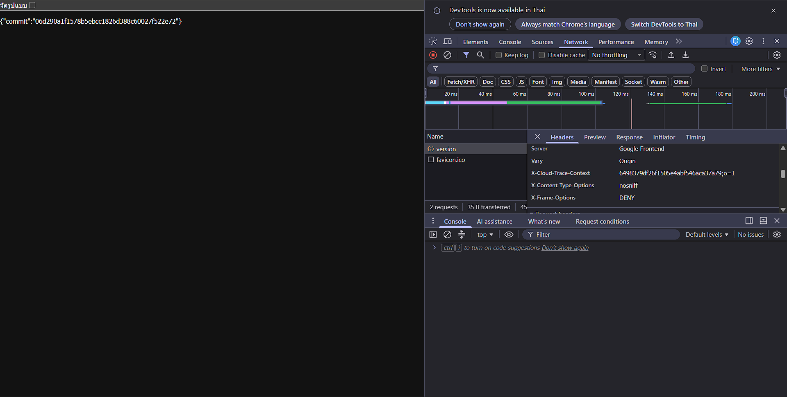

**P-EV01 (UAT-01): `PR-2026-0003` อนุมัติแล้ว total ฿1,351.50 ประวัติครบ 3 ขั้น (22:30)**

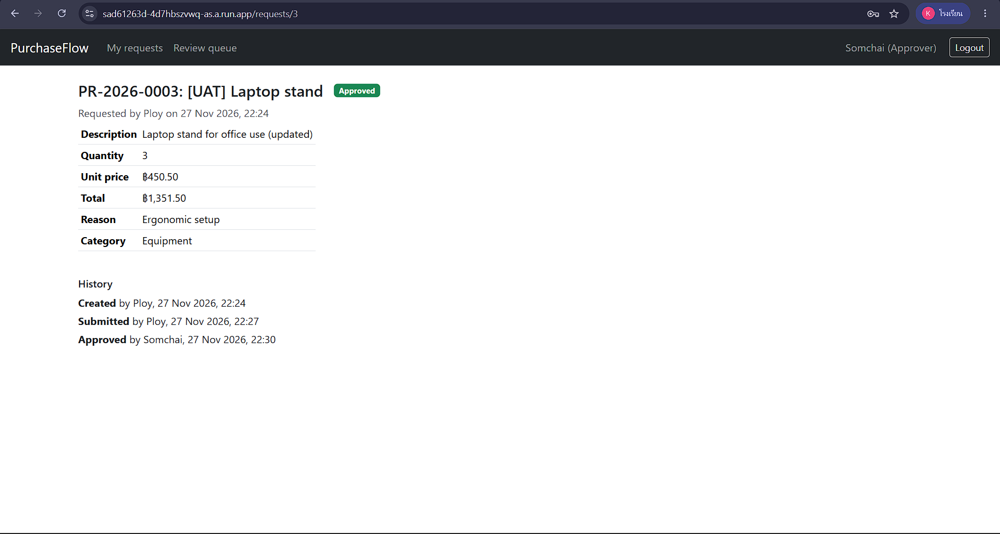

**P-EV02 (UAT-02): ส่ง draft ที่ไม่ครบไม่ได้ ระบบแจ้ง Reason และ Category ที่ขาด (22:42)**

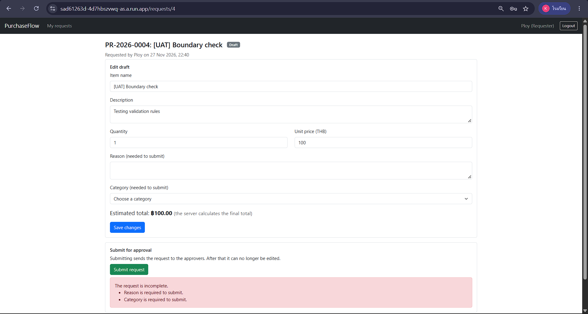

**P-EV03 (UAT-03, negative/access): Requester 2 เปิดคำขอของ Requester 1 ได้ "Request not found." (22:52)**

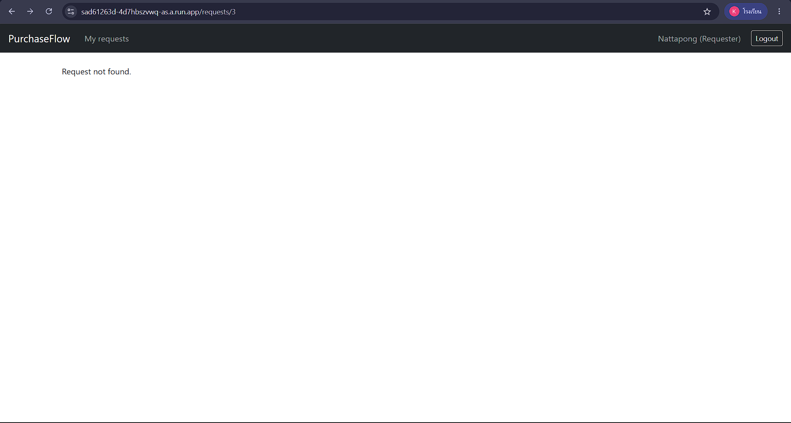

**P-EV04 (UAT-04): หลัง login ใหม่ คำขอยังเหมือนเดิมและไม่มีปุ่มแก้/ส่ง (23:10)**

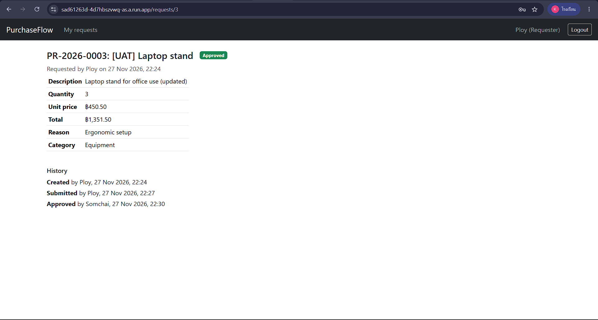

**P-EV05 (UAT-05): บัญชีที่ถูกปิดใช้งาน login ไม่ได้ (23:14)**

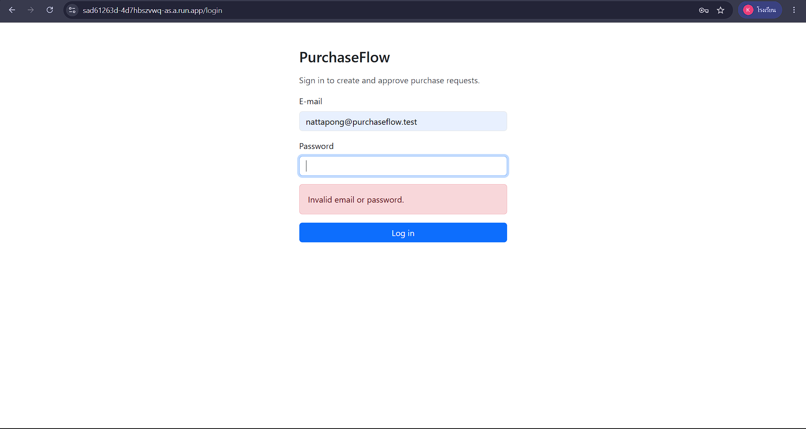

{{mark:B1end}}

## B2. ทีมเรา (Yaowachatteamchon) ทดสอบ SerWongSerWay

{{mark:B2}}

ทดสอบ 26 พ.ย. 2026 22:35 ถึง 23:05 (+07) บน `main` @ `752a76a` ของทีมคู่ ผลรวม PASS 20, FAIL 1 (UAT-SWSW-01, Major), BLOCKED 0, N/A 1 ตารางผลรายเคสและหลักฐานทั้งหมดอยู่ในภาคผนวก (หน้า {{page:U}}) หัวข้อ "2. ผลการทดสอบรายเคส" ตัวอย่างหลักฐานหลัก:

- normal journey: EV04 (Creator สร้าง survey), EV15 (Respondent ส่งคำตอบ), EV16 (ผลรวม 2 คำตอบ ค่าเฉลี่ย 4.5)
- negative/access: EV02 (ไม่ login ได้ 401), EV06 และ EV07 (Creator เปิดผลของ Creator อื่นได้ 403 และไม่เปิดเผยข้อมูล), EV12 (Respondent เปิดผลไม่ได้), EV13 (ส่งซ้ำได้ 409)

{{mark:B2end}}

# Part C: Defect reporting and triage

## C1. Finding ที่ได้รับเกี่ยวกับ PurchaseFlow และการ triage

{{mark:C1}}

ทีมคู่รายงานผ่าน GitHub Issues #67, #68, #69 (เปิดโดย `Khanatip112` วันที่ 28 พ.ย. 2026 01:18 ถึง 01:21 +07) และในส่วน 7 ของ `uat-handoff.md` ทีมเรา triage โดยทำซ้ำตามขั้นตอนที่รายงานกับโค้ดที่ `06d290a` ก่อนตัดสิน และเขียน regression test ที่ fail ตามอาการที่รายงาน (Part D)

| Finding | Issue | Reporter | Version | เคส / requirement | Classification | Severity และเหตุผลจากผลกระทบต่อผู้ใช้ | Owner | สถานะ |
|---|---|---|---|---|---|---|---|---|
| DEF-01 หัวข้อชื่อยาว 100 ตัวไม่มีช่องว่างล้นจอ 375 px | #67 | Khanatip112 | `06d290a` | UAT-EX-01; NFR-05 / AC-53 (ไม่มี horizontal scroll ที่ 375 px) | **Accepted defect** ขัดกับ AC-53 ที่ Sprint 1 สัญญาไว้ ไม่ใช่ feature ใหม่ | **Minor**: ข้อมูลไม่หายและทุกฟังก์ชันยังใช้ได้ แต่บนมือถือต้องเลื่อนซ้ายขวาเมื่อชื่อยาวผิดปกติ | Aphisaimai | แก้แล้วใน `ce99e7b` / `2922c47`, ทดสอบซ้ำผ่าน (P-RET01) **ปิดแล้ว** |
| DEF-02 ตัวอักษรล่องหน (`​` ฯลฯ) ผ่านกฎ "ห้ามว่าง" และ "เหตุผลอย่างน้อย 5 ตัว" | #68 | Khanatip112 | `06d290a` | UAT-EX-02; BR-01, BR-02, BR-06, BR-09 | **Accepted defect** ข้อความที่มองไม่เห็นคือข้อความว่างตามเจตนาของ BR | **Major**: คำขอที่ไม่มีชื่อ/คำอธิบาย/เหตุผลที่อ่านได้เข้าสู่ขั้นอนุมัติได้ และ Approver ปฏิเสธโดยไม่มีเหตุผลที่อ่านได้ ทำลาย audit trail ที่ BR-09 ต้องการ | Aphisaimai | แก้แล้ว, ทดสอบซ้ำผ่าน (P-RET02) **ปิดแล้ว** |
| DEF-03 ผู้ใช้ที่ถูกเลื่อนเป็น ADMIN ยังแก้และส่ง draft เก่าของตัวเองได้ | #69 | Khanatip112 | `06d290a` | UAT-EX-03; AC-17, BR-18 (Admin อ่านอย่างเดียว) | **Accepted defect** ขัดกับกฎ role ใน Sprint 1 | **Major**: ละเมิดการแบ่งสิทธิ์ (separation of duties) ผู้ดูแลระบบสร้างและผลักคำขอเข้าสู่การอนุมัติได้ ทั้งที่ contract กำหนดให้อ่านอย่างเดียว | Aphisaimai | แก้แล้ว, ทดสอบซ้ำผ่าน (P-RET03) **ปิดแล้ว** |

ไม่มี finding อื่น ไม่มี duplicate, not-defect หรือ enhancement ไม่มี minor limitation ที่ต้องให้ UAT Team ยอมรับ เพราะ DEF-01 ซึ่งเป็น minor ก็แก้แล้ว

**P-DEF01 (DEF-01): ที่ 375 px หัวข้อ `PR-2026-0006: WWW…` ล้นขอบจอ (28 พ.ย. 00:52, `06d290a`)**

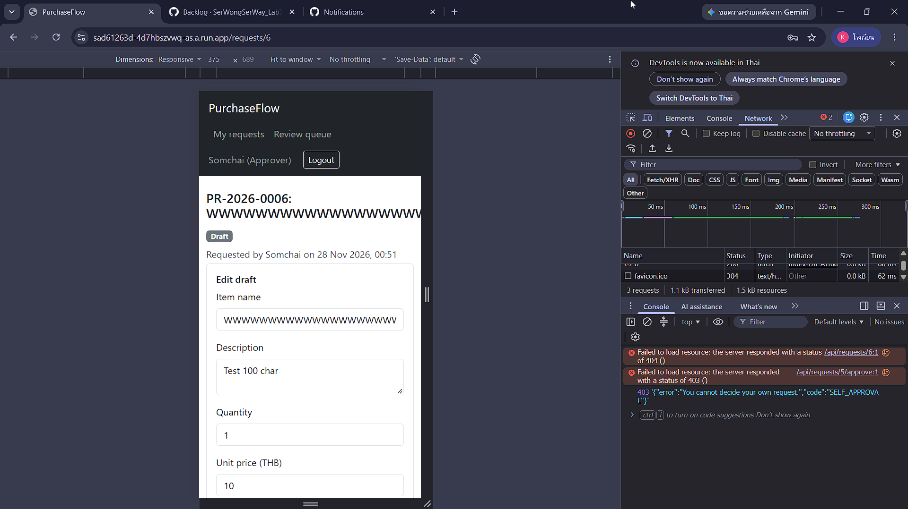

**P-DEF02 (DEF-02): `PR-2026-0007` ที่สร้างด้วย `​` ล้วน ส่งได้และแสดงชื่อ คำอธิบาย และเหตุผลว่างเปล่า (00:54, `06d290a`)**

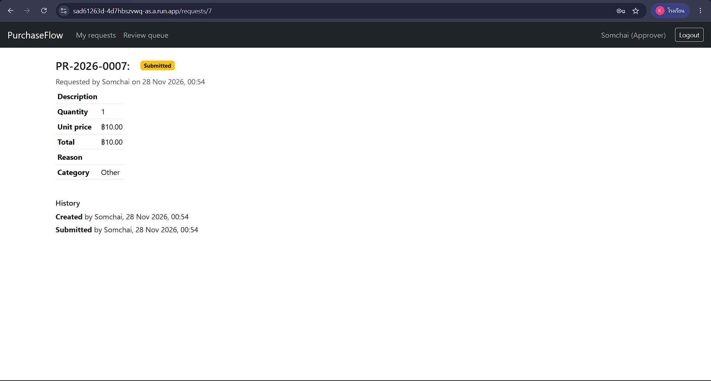

**P-DEF03 (DEF-03): "Ploy (Administrator)" แก้และส่ง `PR-2026-0008` ได้ (01:01, `06d290a`)**

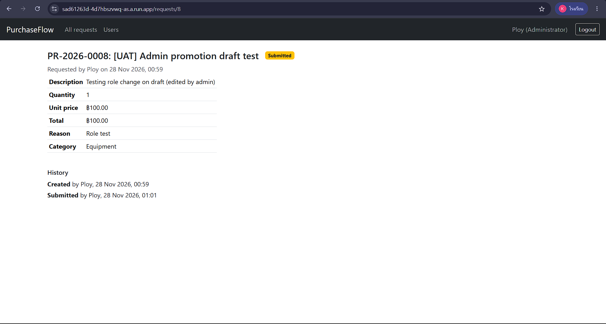

{{mark:C1end}}

## C2. Defect ที่ทีมเรารายงานให้ SerWongSerWay

{{mark:C2}}

| Issue | Severity | สรุป | การแจ้งและผล triage |
|---|---|---|---|
| UAT-SWSW-01 | **Major** | แก้ survey ที่ publish แล้ว (ลบคำถาม) ทำให้คำตอบข้อความของ Respondent ถูกลบถาวร ขัดกับ AC-07 และ AC-10 | แจ้งทาง Discord (D-EV07) Product Team ยอมรับเป็น defect แก้ใน `fbbcd07` (PR #40, merge เป็น `9c7b9eb`) ทีมเราทดสอบซ้ำผ่าน (D2) **ปิดแล้ว** |
| O-2 | minor (เสนอ) | Respondent เปิดผลได้ 403 ถูกต้อง แต่ error code เป็น `FORBIDDEN` แทน `FORBIDDEN_OWNER_ACCESS` ที่ STS TEST-11 ระบุ | รอ Product Team triage |
| O-3 | enhancement (เสนอ) | `GET /api/campaigns/:id` ส่ง `creator.email` ให้ Respondent | รอ Product Team triage |
| O-1 | ไม่รายงานเป็น defect | เคยเห็น "Loading surveys..." ค้างหลัง 403 ครั้งเดียว ทำซ้ำไม่ได้ | บันทึกไว้เป็นข้อสังเกต |

รายงาน defect ฉบับเต็ม (Issue ID, version, เงื่อนไข, ขั้นตอนทำซ้ำ, ผลที่คาดหวัง, ผลจริง, severity, หลักฐาน EV17 ถึง EV22) อยู่ในภาคผนวก หัวข้อ "3. Defect report"

{{mark:C2end}}

# Part D: Resolution and independent retest

## D1. การแก้ DEF-01 ถึง DEF-03 ของ PurchaseFlow

{{mark:D1}}

### D1.1 Traceability

| Issue | Regression test (ไฟล์ / test ID) | โค้ดที่แก้ | Fix commit | PR / review | CI | Release / deploy | ทดสอบซ้ำโดยทีมคู่ |
|---|---|---|---|---|---|---|---|
| #67 DEF-01 | `client/tests/requests/uat-defects.test.tsx` CT-L6-02; `e2e/quality/long-item-name.spec.ts` TEST-L6-E2E-01 | `client/src/RequestDetail.tsx`: `text-break` ที่หัวข้อ | `ce99e7b` | PR #70 approve โดย Thanwarat1303 | `test-and-docker` ผ่าน | `2922c47` / `sad61263d-00006-9c4` | P-RET01 PASS |
| #68 DEF-02 | `server/tests/lab6/uat-defects.test.ts` TEST-L6-01 ถึง 05 | `server/src/validation.ts` (`cleanText`, `visibleLength`), `server/src/requestRoutes.ts` | `ce99e7b` | PR #70 | ผ่าน | เดียวกัน | P-RET02 PASS |
| #69 DEF-03 | `server/tests/lab6/uat-defects.test.ts` TEST-L6-06, 07; client CT-L6-01 | `server/src/requestRoutes.ts` (`isReadOnly` → 404), `client/src/RequestDetail.tsx` (`canEdit`) | `ce99e7b` | PR #70 | ผ่าน | เดียวกัน | P-RET03 PASS |

Issue #67, #68, #69 ปิดอัตโนมัติเมื่อ merge PR #70 (`Fixes #67`, `Fixes #68`, `Fixes #69`) วันที่ 28 พ.ย. 2026 17:38 (+07)

### D1.2 Regression test: เนื้อหาที่ทดสอบ

| Test ID | Setup | Assertion |
|---|---|---|
| TEST-L6-01 | Requester ส่ง itemName/description ที่มีแต่ `​`, `‌`, `‍`, ``, `⁠` | ได้ 422 พร้อม `fields.itemName` / `fields.description` และจำนวนคำขอในฐานข้อมูลไม่เพิ่ม |
| TEST-L6-02 | itemName `"​ Laser printer ​"`, description ภาษาไทยและอีโมจิ | 201, เก็บ `"Laser printer"` และข้อความไทย/อีโมจิไม่เปลี่ยน |
| TEST-L6-03 | draft ที่ reason เป็น `​` × 3 | submit ได้ 422 `INCOMPLETE` และยังเป็น DRAFT |
| TEST-L6-04 | reason ล่องหนที่บันทึกไว้ก่อนแก้ (เขียนตรงลง DB) | submit ได้ 422 |
| TEST-L6-05 | Approver reject ด้วย `​` × 5, × 10 และ `"ab​​cd"` | 422 `REASON_REQUIRED` และยังเป็น SUBMITTED, เหตุผล `"​Over budget​"` ผ่านและเก็บเป็น `"Over budget"` |
| TEST-L6-06 | Requester สร้าง draft แล้วถูกเลื่อนเป็น ADMIN (ผ่าน Prisma, คืนค่าใน `finally`) | PATCH และ submit ได้ 404 ทั้ง session ใหม่และ session เดิม, ข้อมูลไม่เปลี่ยน (snapshot เท่าเดิม), GET ยังได้ 200 |
| TEST-L6-07 | ลดกลับเป็น REQUESTER | เจ้าของแก้และส่ง draft เดิมได้ (200) |
| CT-L6-01 | Admin เป็นเจ้าของ draft (mock API) | ไม่มี region "Edit draft" และปุ่ม "Submit request" |
| CT-L6-02 | itemName `"W".repeat(100)` | หัวข้อมี class `text-break` |
| TEST-L6-E2E-01 | Playwright viewport 375 × 800, สร้างคำขอชื่อ `"W".repeat(100)` | `document.documentElement.scrollWidth <= window.innerWidth` |

คำสั่งที่ใช้:

```
npm --prefix server test -- tests/lab6
npm --prefix client test -- tests/requests/uat-defects.test.tsx
npx playwright test e2e/quality/long-item-name.spec.ts
```

### D1.3 RED: test ใหม่รันกับโค้ดที่มี defect (`06d290a`)

ทุก test fail ด้วยเหตุผลตามที่รายงาน (ไม่ใช่ syntax error หรือ fixture เสีย) TEST-L6-07 ผ่านตั้งแต่แรกเพราะเป็นกรณีปกติที่ต้องยังทำงานหลังแก้

**R-RED-1: server, `06d290a`: 6 failed, 1 passed (7)**

{{file:evidence/product/regression/red-server.txt}}

**R-RED-2: client, `06d290a`: 2 failed (2)**

{{file:evidence/product/regression/red-client.txt}}

**R-RED-3: Playwright 375 px, `06d290a`: 1 failed**

{{file:evidence/product/regression/red-e2e.txt}}

**R-RED-4: ภาพจาก Playwright ตอน fail: หัวข้อล้นจอ 375 px**

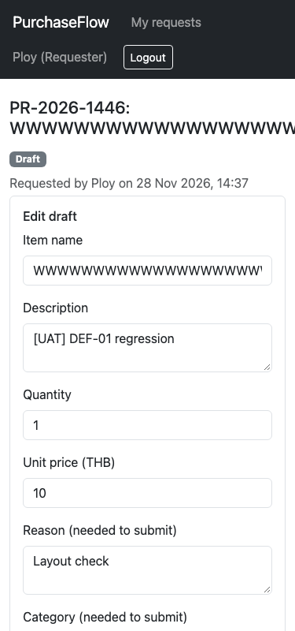

### D1.4 GREEN: test เดียวกันหลังแก้ (`ce99e7b`) และ regression ทั้งหมด

**R-GREEN-1: server: 7 passed (7)**

{{file:evidence/product/regression/green-server.txt}}

**R-GREEN-2: client: 2 passed (2)**

{{file:evidence/product/regression/green-client.txt}}

**R-GREEN-3: Playwright: TEST-L6-E2E-01 และ TEST-88 (responsive เดิม) 2 passed**

{{file:evidence/product/regression/green-e2e.txt}}

**R-GREEN-4: ชุด test ทั้งหมดหลังแก้: server 108/108, client 16/16, e2e 14/14, typecheck และ build ผ่าน, skipped 0**

{{file:evidence/product/regression/green-full.txt}}

### D1.5 Code diff, review, CI และ deploy

**D-DIFF: diff ของโค้ดที่แก้ (`06d290a` → `2922c47`, ไม่รวมไฟล์ test)**

{{file:evidence/product/d-fix-diff.txt}}

| ขั้น | หลักฐาน |
|---|---|
| Fix branch | `fix/lab6-uat-defects` แตกจาก `06d290a` (commit ที่ deploy และถูกทดสอบ) ดูข้อจำกัดเรื่อง branch `staging` ในหัวข้อ E |
| Pull request | PR #70 "fix(lab6): fix DEF-01, DEF-02 and DEF-03 from the partner team's Sprint 1 UAT" `fix/lab6-uat-defects` → `main`, 15 ไฟล์ |
| CI บน PR | GitHub Actions `test-and-docker` บน `ce99e7b`: **success** (run 46122667861, 28 พ.ย. 14:45 +07, 1m46s) รัน server test, client test และ Docker build |
| Review | Thanwarat1303 **APPROVED** 28 พ.ย. 2026 17:38 (+07) ข้อความด้านล่าง |
| Merge | 28 พ.ย. 2026 17:38:57 (+07) → merge commit `2922c474fb38bde6719676c3f23fee1354beab66` |
| Deploy | workflow `deploy.yml` (run 46136167387) จาก push เข้า `main`: job `test / test-and-docker` success และ `deploy` success, 17:39 ถึง 17:43 (+07) |
| Revision | `sad61263d-00006-9c4` รับ traffic 100% |

ข้อความ review ของ Thanwarat1303 (PR #70, APPROVED):

> I reviewed the Lab 6 UAT defect-fix branch. DEF-01, DEF-02 and DEF-03 are addressed in both the implementation and regression tests. The RED/GREEN evidence is included, and the reported server, client and Playwright suites all pass. I found no blocking issue. This is ready to approve and merge into `main`. After merging, please deploy the new release, record the Cloud Run revision and `/api/version` commit, then ask the partner team to retest UAT-EX-01 to UAT-EX-03 and update `uat-handoff.md` with the retest results.

**D-SMOKE: smoke check หลัง deploy บน Production URL**

{{file:evidence/product/d-smoke-after-deploy.txt}}

### D1.6 ทดสอบซ้ำโดยทีมคู่ และผลตัดสิน

ทีมเราแจ้ง URL, commit `2922c47`, revision `sad61263d-00006-9c4`, PR #70 และเคสเดิม (UAT-EX-01 ถึง EX-03) ให้ทีมคู่ทาง Discord และไม่ deploy อะไรเพิ่มระหว่างที่ทีมคู่ทดสอบ ทีมคู่ทดสอบซ้ำและอัปโหลดรูปไว้ในโฟลเดอร์ Drive `UAT/RET` (เจ้าของไฟล์ `khanatip.nokk`, 28 พ.ย. 2026 18:52 ถึง 19:07 +07) รูปโหลดไฟล์ `index-CeRyV5iL.js` ซึ่งตรงกับ bundle ที่ `2922c47` เสิร์ฟ (D-SMOKE ข้อ 5)

| Defect | เคสเดิม | การกระทำที่ทดสอบซ้ำ | ผลจริง | ผล | หลักฐาน |
|---|---|---|---|---|---|
| DEF-01 | UAT-EX-01 | เปิด `PR-2026-0006` (ชื่อ `W` × 100) ที่ 375 px | ชื่อตัดขึ้นบรรทัดใหม่ 7 บรรทัดภายในหน้า ไม่ล้นจอ | **PASS** | P-RET01 |
| DEF-02 | UAT-EX-02 | Approver reject `PR-2026-0008` ด้วย `"​".repeat(5)` | `POST /api/requests/8/reject` → 422 และหน้าเว็บแจ้งว่าเหตุผลต้องมีอย่างน้อย 5 ตัวอักษร คำขอยังเป็น Submitted | **PASS** | P-RET02 |
| DEF-03 | UAT-EX-03 | บัญชีถูกเลื่อนเป็น ADMIN ขณะเปิด draft `PR-2026-0009` ค้างไว้ แล้วกดบันทึก | `PATCH /api/requests/9` → 404 "Request not found." ไม่มีอะไรเปลี่ยน | **PASS** | P-RET03 |

หมายเหตุ P-RET03: หัวเว็บยังแสดง "(Approver)" และยังเห็นฟอร์ม เพราะแท็บนั้นโหลดก่อนถูกเลื่อน role และไม่ได้ refresh server อ่าน role จากฐานข้อมูลทุก request จึงปฏิเสธ (ตรงกับกรณี session เดิมใน TEST-L6-06) เมื่อ reload แล้ว ADMIN จะไม่เห็นฟอร์มและปุ่ม Submit (CT-L6-01)

| ผลตัดสิน PurchaseFlow Sprint 1 | รายละเอียด |
|---|---|
| Release ที่ทดสอบซ้ำ | `2922c47`, revision `sad61263d-00006-9c4`, https://sad61263d-4d7hbszvwq-as.a.run.app |
| ผู้ทดสอบอิสระ | UAT Team SerWongSerWay: Khanatip Nokkhunthot, Chetsada Kiatkamonwong (รูปทดสอบซ้ำอัปโหลดโดย `khanatip.nokk`) |
| วันที่ | 28 พ.ย. 2026 |
| Defect ที่ค้าง | ไม่มี (DEF-01 Minor, DEF-02 Major, DEF-03 Major แก้และทดสอบซ้ำผ่านทั้งหมด) |
| Minor limitation ที่ยอมรับ | ไม่มี |
| ผลตัดสินสุดท้าย | **รอ UAT Team ยืนยันเป็นลายลักษณ์อักษร** ในส่วน 9 ของ `uat-handoff.md` ทีมเราไม่ได้ตัดสินแทน UAT Team ตามที่ใบงานกำหนด หลักฐานทดสอบซ้ำทั้ง 3 ข้อผ่านและไม่มี defect ค้าง |

**P-RET01 (DEF-01): ที่ 375 px ชื่อยาวตัดบรรทัดภายในหน้า (UAT Team, `2922c47`)**

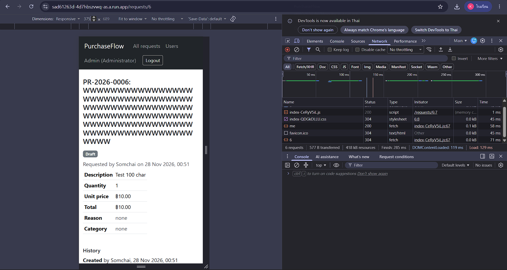

**P-RET02 (DEF-02): reject ด้วย `​` × 5 ได้ 422 (UAT Team, `2922c47`)**

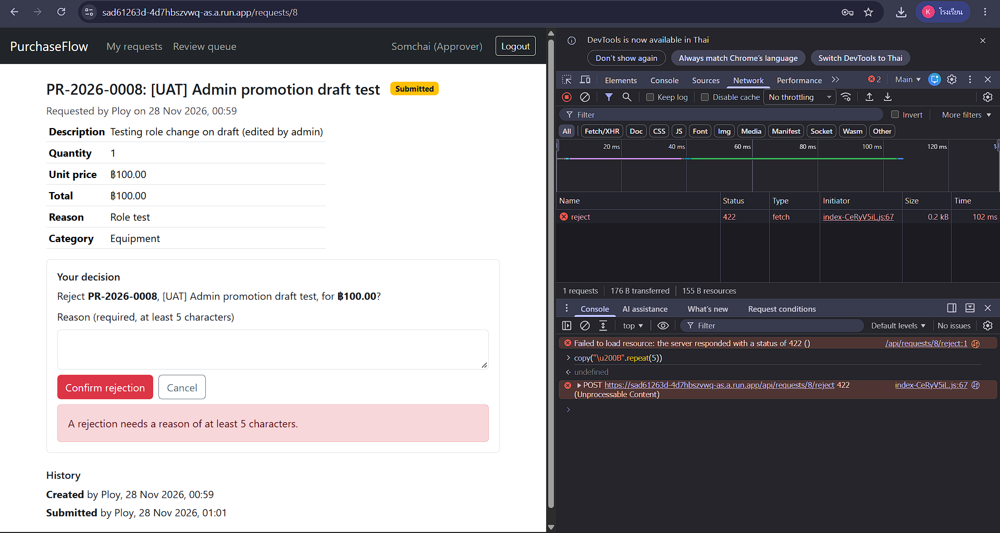

**P-RET03 (DEF-03): ADMIN บันทึก draft ได้ `PATCH` 404 (UAT Team, `2922c47`)**

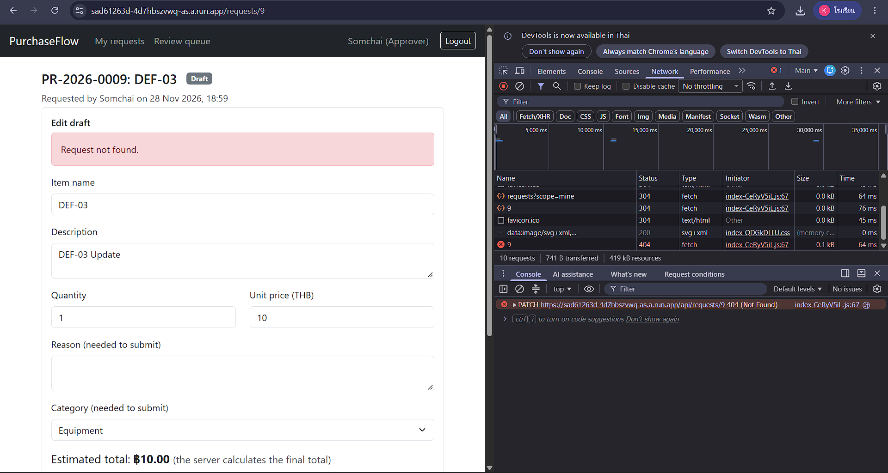

{{mark:D1end}}

## D2. ทีมเราทดสอบซ้ำ UAT-SWSW-01 ของ SerWongSerWay

{{mark:D2}}

| รายการ | รายละเอียด |
|---|---|
| Version | `main` @ `9c7b9eb`, revision `serwongserway-00012-x7s` (ตามที่ Product Team แจ้ง) |
| ผู้ทดสอบ | UAT Team Yaowachatteamchon (Thanwarat Chanthana, Aphisaimai) |
| วันเวลา | 28 พ.ย. 2026, 14:30 ถึง 14:33 (+07) |
| ผล | 8 ขั้น PASS ทั้งหมด: หน้า edit ของ survey ที่ publish แล้วถูกล็อก, `PUT` 3 แบบได้ 409 `CAMPAIGN_NOT_EDITABLE`, คำตอบเดิมอยู่ครบ (2 submissions, ค่าเฉลี่ย 4.5), DRAFT ยังแก้ได้, ไม่ login ได้ 401 |
| ผลตัดสินของทีมเรา (UAT Team) ต่อ SerWongSerWay Sprint 1 | **Accepted with documented minor limitations** ไม่มี defect critical/major ค้าง, O-2 และ O-3 (minor/enhancement) รอ Product Team triage |

ตารางขั้นตอนและหลักฐาน D-EV01 ถึง D-EV07 อยู่ในภาคผนวก หัวข้อ "3.1 ทดสอบซ้ำ UAT-SWSW-01 (Part D)"

{{mark:D2end}}

# Contribution, การใช้ AI และข้อจำกัด

{{mark:E}}

## Contribution

| งาน | Thanwarat Chanthana | Aphisaimai | หลักฐาน |
|---|---|---|---|
| Part A: เขียน handoff, UAT-01 ถึง UAT-05, บัญชีทดสอบ, setup/cleanup | ✓ (หลัก) | | commit `0d67c30`, `30431f3`, `9a1eb12` บน `staging` |
| ส่งรหัสผ่านบัญชีทดสอบให้ทีมคู่ทางช่องทางส่วนตัว | ✓ | ✓ | (ไม่ใส่ใน PDF) |
| Part B2: ทดสอบ SerWongSerWay และบันทึกผล | ✓ (ผู้ทดสอบอิสระรอบแรก) | ✓ (รัน exploratory case, API check, แคปหน้าจอ) | ภาคผนวก |
| Part C2: รายงาน UAT-SWSW-01 และแจ้งทีมคู่ | ✓ | ✓ | D-EV07 |
| Part C1: triage DEF-01 ถึง DEF-03 | ✓ (review) | ✓ (ทำซ้ำและจัด severity) | C1 |
| Part D1: regression test, RED/GREEN, แก้โค้ด, PR #70 | | ✓ | `ce99e7b`, PR #70 |
| Part D1: review และ approve PR #70, merge | ✓ | | review ใน D1.5 |
| Part D1: deploy, smoke check, แจ้งทีมคู่ทดสอบซ้ำ | | ✓ | D-SMOKE |
| Part D2: ทดสอบซ้ำ UAT-SWSW-01 | | ✓ | D-EV01 ถึง D-EV06 |
| รวบรวมรายงานและ PDF | ✓ (ร่างแรก) | ✓ | ไฟล์นี้ |

งาน triage และการตัดสินผล UAT ทำร่วมกันเป็นคู่

## การใช้ AI

ใช้ AI coding assistant ช่วยรันขั้นตอนทดสอบผ่าน API และ browser, แคปหน้าจอ, เขียน regression test และโค้ดแก้ defect รุ่นแรก และร่างรายงาน การ login ทุกครั้งทำโดยนักศึกษา นักศึกษากำหนดขอบเขต อ่านและตรวจโค้ด test และผลลัพธ์ทั้งหมด และรับผิดชอบเนื้อหา ผลการทดสอบในรายงานนี้มาจากคำสั่งและหน้าจอที่บันทึกไว้จริง ไม่มีรหัสผ่าน token หรือ secret ถูกส่งให้ AI หรือใส่ใน Git และ PDF

## ข้อจำกัด

- **Fix branch ไม่ได้แตกจาก `staging`:** ใบงานให้แตก fix branch จาก sprint staging แต่ทีมเราแตก `fix/lab6-uat-defects` จาก `06d290a` ซึ่งเป็น commit ที่ deploy และถูกทดสอบจริง แล้ว PR เข้า `main` โดยตรง เพื่อให้ release ที่แก้ต่างจาก release ที่ทดสอบเฉพาะการแก้ defect (เพราะ `staging` มีงาน Sprint 2 อยู่แล้ว) ยังมี review, CI และ deploy ครบ ยังต้อง merge `main` กลับเข้า `staging` (ยังไม่ได้ทำ)
- **ผลตัดสินสุดท้ายของ PurchaseFlow:** ทีมคู่ทดสอบซ้ำผ่านทั้ง 3 ข้อ (P-RET01 ถึง P-RET03) แต่ ณ เวลาที่ทำรายงาน ยังไม่ได้กรอกส่วน 7 (Fix commit, Retest result) และส่วน 9 (ผลตัดสิน) ของ `uat-handoff.md`
- **DEF-02 ใน P-RET02** ทดสอบซ้ำเฉพาะเหตุผลการ reject บนเว็บจริง ส่วน itemName, description และ reason ตรวจด้วย TEST-L6-01 ถึง 04 ใน regression test
- **ข้อมูลทดสอบที่เหลือบน PurchaseFlow:** `PR-2026-0003` ถึง `PR-2026-0009` (ขึ้นต้นด้วย `[UAT]` หรือสร้างระหว่าง UAT) เก็บไว้เป็นหลักฐาน
- **SerWongSerWay:** O-2 และ O-3 ยังไม่ได้รับผล triage จาก Product Team ทีมเราไม่ได้ตรวจรายละเอียดคำตอบข้อความรอบแรกหลังแก้ เพราะคำตอบเดิมหายไปตั้งแต่ก่อนแก้ (ดูภาคผนวก)
- **Sprint 2 `POST /requests/:id/cancel`** ควรมีการตรวจ ADMIN แบบเดียวกัน แต่อยู่นอก scope ของ Sprint 1

{{mark:Eend}}

# ภาคผนวก: รายงาน UAT ของทีมเราต่อ SerWongSerWay (ฉบับเต็ม)

{{mark:U}}

{{md:uat-report-serwongserway.md}}

{{mark:last}}
