# รายงานผลการทดสอบ UAT: SerWongSerWay (PastelPulse) Sprint 1

| รายการ | รายละเอียด |
|---|---|
| Product Team | SerWongSerWay (repo `Khanatip112/SerWongSerWay`) |
| UAT Team | Thanwarat Chanthana 67070501025, Aphisaimai 67070501077 |
| URL ที่ทดสอบ | https://serwongserway-vs56b635aq-as.a.run.app |
| Version ที่ทดสอบ | รอบแรก: `main` @ `752a76a` รอบทดสอบซ้ำ (Part D): `main` @ `9c7b9eb`, Cloud Run revision `serwongserway-00012-x7s` (ตามที่ Product Team แจ้ง) |
| วันเวลาทดสอบ | รอบแรก: 26 พ.ย. 2026, 22:35 ถึง 23:05 (+07) รอบทดสอบซ้ำ: 28 พ.ย. 2026, 14:30 ถึง 14:33 (+07) |
| ขอบเขต | Sprint 1 contract AC-01 ถึง AC-12 (`docs/sprints/sprint-1/contracts.md` ของ Product Team) และ exploratory case EX-02 ถึง EX-09 |
| บัญชีที่ใช้ (ไม่ระบุรหัสผ่าน) | Creator A (james), Creator B (william), Respondent A (amelia), Respondent B (daniel) |
| วิธีทดสอบ | Manual ผ่าน UI ใน Chrome ร่วมกับเรียก API ด้วย session ของ UI ที่ login อยู่ ผลทั้งหมดเป็นผลจริงที่สังเกตได้ |
| การใช้ AI | AI coding assistant ช่วยรันขั้นตอนทดสอบ แคปหน้าจอ และร่างรายงาน การ login ทุกครั้งทำโดยนักศึกษา |

## 1. สรุปผล

| ผล | จำนวน |
|---|---|
| PASS | 20 |
| FAIL | 1 (UAT-SWSW-01, Major) |
| BLOCKED | 0 |
| N/A (ข้ามโดยเจตนา) | 1 |
| ทดสอบซ้ำ EX-06 บน `9c7b9eb` | **PASS** (UAT-SWSW-01 แก้แล้วและยืนยันผลแล้ว) |

**ผลรอบแรก (26 พ.ย.):** Not Accepted เพราะมี defect ระดับ Major 1 รายการ (UAT-SWSW-01)

**ผลตัดสินสุดท้ายหลังทดสอบซ้ำ (28 พ.ย.):** **Accepted with documented minor limitations** เพราะ UAT-SWSW-01 ซึ่งเป็น defect ระดับ Major รายการเดียวได้รับการแก้และยืนยันผลแล้ว (หัวข้อ 3.1) ไม่มี defect ระดับ critical หรือ major ค้างอยู่ ข้อจำกัดที่ยังเหลือคือ O-2 และ O-3 ซึ่งเป็นระดับ minor และ Product Team ยังไม่ได้ระบุผล triage (หัวข้อ 4)

## 2. ผลการทดสอบรายเคส

| Case ID | AC | เวลา | Input / การกระทำ | ผลจริง | ผล | หลักฐาน |
|---|---|---|---|---|---|---|
| B-SYS-01 | AC-12 | 22:35 | `GET /api/ready` | 200 `{"status":"ready","database":"connected"}` | PASS | EV01 |
| B-AUTH-03 | AC-03 | 22:35 | `GET /api/campaigns` โดยไม่มี cookie | 401 `UNAUTHENTICATED` และไม่มีข้อมูลหลุด | PASS | EV02 |
| B-AUTH-02a | AC-02 | 22:35 | login ด้วยอีเมลที่ไม่มีในระบบ | 401 `INVALID_CREDENTIALS` | PASS | log |
| B-CAM-06a | AC-06 | 22:38 | Creator A เปิดรายการ survey | แสดง 8 รายการ เป็นของ Creator A ทั้งหมด | PASS | EV03 |
| B-CAM-04 | AC-04 | 22:39 | สร้าง "UAT-Claude Main (EX)" มีคำถาม RATING_5 และ TEXT | 201 และขึ้นในรายการว่า "2 Questions" | PASS | EV04 |
| B-CAM-05a | AC-05 | 22:39 | title เป็นช่องว่างล้วน | 400 "Title is required" | PASS | log |
| B-CAM-05b | AC-05 | 22:39 | `questions: []` | 400 "At least one question is required…" | PASS | log |
| EX-04a | Business rule | 22:39 | `closesAt` เป็นเวลาที่ผ่านไปแล้ว | 400 "Closing deadline must be in the future." | PASS | log |
| B-CAM-05c | AC-05 (UI) | 22:40 | กด Publish ตอนชื่อว่าง | ฟอร์มขึ้น "Please fill out this field." และไม่สร้าง survey | PASS | EV05 |
| B-OWN-11a | AC-11 | 22:41 | Creator A เปิดผลลัพธ์ของ Creator B (`…03`, `…06`, `…09`) | 403 `FORBIDDEN_OWNER_ACCESS` ไม่มี data และ UI ขึ้นแจ้งเตือนสีแดง | PASS | EV06, EV07 |
| EX-08 | AC-02 | 22:42 | กด Log out แล้วกด Back | กลับไปหน้า login พร้อมข้อความ "Please sign in…" และ `/me` ได้ 401 | PASS | EV09, EV10 |
| B-CAM-06b | AC-06 | 22:46 | Respondent A เปิดรายการ survey | เห็นเฉพาะ 7 รายการที่ PUBLISHED ไม่เห็น DRAFT และ survey ที่ปิดแล้ว | PASS | EV11 |
| EX-03 | AC-09 / BR-02 | 22:46 | ส่งคำตอบหลัง survey ปิด | 422 `CAMPAIGN_NOT_OPEN` | PASS | EV14 |
| EX-02 | AC-09 / BR-03 | 22:46 | rating 0, 6 และ 4.5 | 400 ทั้งสามกรณี | PASS | EV14 |
| B-SUB-03 | BR-03 | 22:46 | ไม่ตอบคำถาม TEXT ที่บังคับตอบ | 400 | PASS | EV14 |
| B-SUB-07 | AC-07 | 22:46 | rating 5 พร้อมข้อความ | 201 และหลังโหลดหน้าใหม่ยังแสดง 5/5 พร้อมข้อความ | PASS | EV13, EV14 |
| EX-09 | AC-08 / BR-01 | 22:46 | ส่ง 2 ครั้งพร้อมกัน แล้วส่งซ้ำอีกครั้ง | ได้ 201 หนึ่งครั้ง 409 หนึ่งครั้ง แล้ว 409 อีกครั้ง | PASS | EV13, EV14 |
| B-OWN-11b | AC-11 | 22:46 | Respondent เปิดหน้าผลลัพธ์ | 403 ไม่มี data (error code เป็น `FORBIDDEN` ดู O-2) | PASS | EV12, EV14 |
| B-CAM-05d | AC-05 | 22:46 | Respondent สร้าง campaign | 403 `FORBIDDEN` | PASS | EV14 |
| B-SUB-07b | AC-07 | 22:57 | Respondent B ส่ง rating 4 พร้อมข้อความ | 201 และ UI แสดง 4/5 พร้อมข้อความ | PASS | EV15 |
| B-RES-10 | AC-10 | 23:04 | Creator A เปิดผลลัพธ์ | Total 2, ค่าเฉลี่ย 4.5 (คาดไว้ (5+4)/2 = 4.5) และแสดงคำตอบครบ | PASS | EV16, EV17 |
| **EX-06** | AC-10 / AC-07 | 23:05 | แก้ survey ที่ PUBLISHED และมีคนตอบแล้ว โดยลบคำถามที่ 2 | บันทึกได้โดยไม่มีคำเตือน และ**คำตอบข้อความของทั้งสองคนหายไปถาวร** | **FAIL** | EV18 ถึง EV22 |
| **EX-06 (retest)** | AC-10 / AC-07 | 28 พ.ย. 14:31 | บน `9c7b9eb`: เปิด `/campaigns/<id>/edit` ของ survey PUBLISHED และส่ง `PUT` เพื่อแก้คำถาม | หน้า edit ถูกล็อก, `PUT` ได้ 409 `CAMPAIGN_NOT_EDITABLE` และคำตอบเดิมยังอยู่ครบ | **PASS** | D-EV01 ถึง D-EV06 |
| รอบ Creator B | AC-11 | n/a | ข้ามโดยเจตนา | กรณี Creator เปิดผลลัพธ์ของ Creator อีกคนทดสอบแล้วใน B-OWN-11a | N/A | |

## 3. Defect report

### UAT-SWSW-01: แก้ survey ที่ publish แล้ว ทำให้คำตอบที่ Respondent ส่งมาแล้วถูกลบถาวร

| ฟิลด์ | รายละเอียด |
|---|---|
| Issue ID | UAT-SWSW-01 |
| Product Team | SerWongSerWay |
| ผู้รายงาน | UAT Team (ชื่อตามหัวรายงาน) |
| Version | `main` @ `752a76a` |
| เคส / requirement | EX-06; AC-10 ("all persisted respondent answers") และ AC-07 ("durably stored") |
| Severity | **Major**: ข้อมูลที่ผู้ใช้ส่งมาหายถาวร ไม่มีคำเตือนและไม่มี undo ค่าเฉลี่ยยังดูปกติ ทำให้ Creator อาจไม่รู้ตัวว่าข้อมูลหาย |
| เงื่อนไขก่อนทดสอบ | survey PUBLISHED ของ Creator A มี Q1 RATING_5 และ Q2 TEXT (บังคับตอบทั้งคู่) Respondent A ตอบ 5 พร้อมข้อความ และ Respondent B ตอบ 4 พร้อมข้อความ |
| ขั้นตอน | 1. login เป็น Creator A 2. เปิด `/campaigns/<id>/results` จะเห็น 2 submissions ที่มีคำตอบข้อความ 3. เปิด `/campaigns/<id>/edit` (หน้าเขียนว่า "Edit Survey Draft" ทั้งที่ survey publish แล้ว) 4. กด Remove ที่ Question 2 5. กด Publish Survey 6. เปิดหน้า results อีกครั้ง |
| ผลที่คาดหวัง | คำตอบที่ส่งมาแล้วยังอยู่ครบ หรือระบบไม่ให้ลบคำถามเมื่อมีคนตอบแล้ว หรืออย่างน้อยต้องมีคำเตือนให้ยืนยันก่อน |
| ผลจริง | บันทึกได้ทันที ยังแสดง "Total Submissions 2" แต่คำตอบข้อความ "Daniel UAT answer" และ "Amelia concurrent A" หายไป |
| สาเหตุที่น่าจะเป็น | `PUT /api/campaigns/:id` เรียก `question.deleteMany` และ `Answer.question` ตั้งเป็น `onDelete: Cascade` โดยไม่เช็กว่ามี submission แล้วหรือยัง |
| ประเภท | Defect ขัดกับ Sprint 1 contract (AC-07, AC-10) ไม่ใช่ feature request |
| แจ้ง Product Team | Discord, 28 พ.ย. 2026 เวลา 01:36 (+07) ส่งลิงก์โฟลเดอร์ Drive ผล UAT ในช่องแชทของสองทีม (D-EV07) Product Team ตอบรับว่าเป็น defect แก้ใน `9c7b9eb` แล้วขอให้ทดสอบซ้ำเฉพาะเคส EX-06 |
| Triage จาก Product Team | Accepted defect แก้ใน `fbbcd07` (PR #40, merge เป็น `9c7b9eb`) โดยล็อกหน้า edit และให้ `PUT /api/campaigns/:id` ตอบ 409 เมื่อ survey ไม่ใช่ DRAFT พร้อมเพิ่ม regression test `server/src/test/uat-swsw-01.test.ts` |
| สถานะ | **ปิดแล้ว (Fixed, verified)** ทดสอบซ้ำผ่านเมื่อ 28 พ.ย. 2026 ดูหัวข้อ 3.1 |

**ก่อนแก้ (EV17):** แต่ละ submission มีคำตอบข้อความ

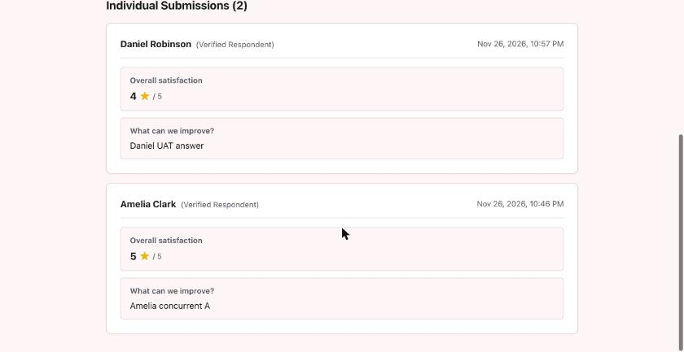

**หน้า edit เปิดได้กับ survey ที่ publish แล้ว (EV18) และลบ Question 2 ออก (EV19)**

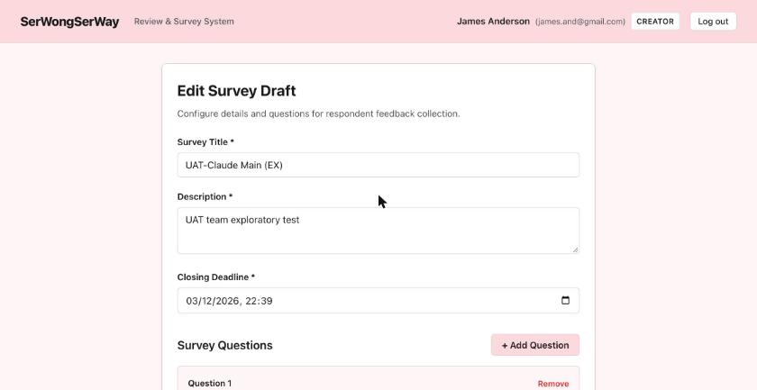

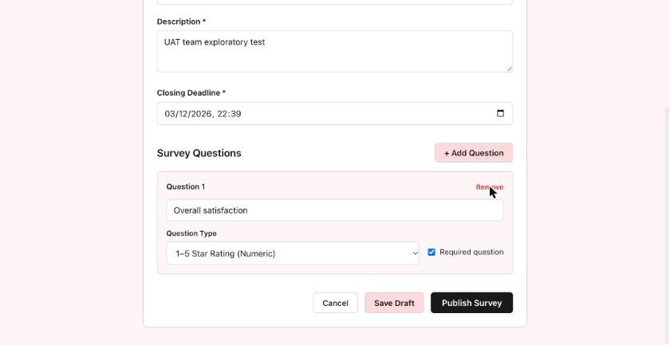

**หลังบันทึก (EV20): เหลือ 1 Questions แต่ยังมี 2 Submissions**

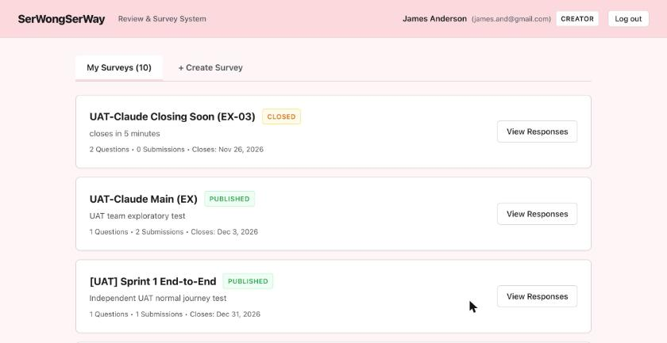

**หลังแก้ (EV21): คำตอบข้อความหายไปทั้งสองคน**

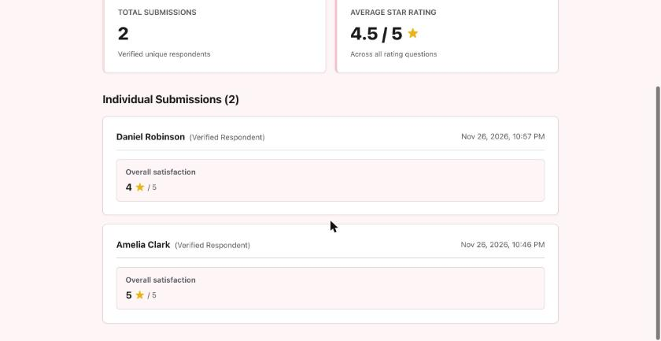

**EV22: สถานะใน API ก่อนและหลังแก้**

{{file:evidence/b-ev22-ex06-api-before-after.txt}}

### 3.1 ทดสอบซ้ำ UAT-SWSW-01 (Part D)

| รายการ | รายละเอียด |
|---|---|
| Version | `main` @ `9c7b9eb`, revision `serwongserway-00012-x7s` ตามที่ Product Team แจ้ง ที่ https://serwongserway-vs56b635aq-as.a.run.app |
| ผู้ทดสอบ | UAT Team, login เป็น Creator A (นักศึกษาเป็นผู้ login) |
| วันเวลา | 28 พ.ย. 2026, 14:30 ถึง 14:33 (+07) |
| ข้อมูลตั้งต้น | survey "UAT-Claude Main (EX)" (PUBLISHED) มี 2 submissions (Respondent B ให้ 4 และ Respondent A ให้ 5) และ survey EX-03 ที่ปิดแล้ว (CLOSED) |

| ขั้น | การกระทำ | ผลที่คาดหวัง | ผลจริง | ผล |
|---|---|---|---|---|
| 1 | เปิดหน้า results ก่อนทดสอบ | 2 submissions, ค่าเฉลี่ย 4.5 | ตรงตามที่คาด (D-EV01) | PASS |
| 2 | เปิด `/campaigns/<id>/edit` ของ survey ที่ PUBLISHED โดยตรง | แก้ไขไม่ได้ | ขึ้นหน้า "Survey Cannot Be Edited" แจ้งว่า survey ที่ publish แล้วถูกล็อก และไม่มีฟอร์มให้แก้ (D-EV02) | PASS |
| 3 | `PUT` survey ที่ PUBLISHED โดยเปลี่ยนคำถามเป็นคำถามใหม่ | ถูกปฏิเสธ | 409 `CAMPAIGN_NOT_EDITABLE` | PASS |
| 4 | `PUT` survey ที่ PUBLISHED โดยตั้ง status เป็น DRAFT และส่ง `questions: []` | ถูกปฏิเสธ (เลี่ยงด้วยการเปลี่ยน status กลับเป็น DRAFT ไม่ได้) | 409 `CAMPAIGN_NOT_EDITABLE` | PASS |
| 5 | `PUT` survey EX-03 ที่ CLOSED | ถูกปฏิเสธ | 409 `CAMPAIGN_NOT_EDITABLE` | PASS |
| 6 | เปิดหน้า results หลังทดสอบ | คำตอบเดิมอยู่ครบ | ยังเป็น 2 submissions, ค่าเฉลี่ย 4.5 และคำตอบ 4 กับ 5 อยู่ครบ (D-EV03) | PASS |
| 7 | Regression: สร้าง survey DRAFT ใหม่แล้วแก้ไข | DRAFT ยังแก้ไขได้ตามปกติ | `POST` ได้ 201, `PUT` (เปลี่ยนชื่อและเพิ่มคำถาม) ได้ 200 และหน้า edit ยังเปิดฟอร์มได้ (D-EV04) | PASS |
| 8 | `PUT` โดยไม่ login | 401 | 401 | PASS |

**ข้อจำกัดที่บันทึกไว้:** คำตอบข้อความที่ถูกลบในรอบแรก ("Daniel UAT answer" และ "Amelia concurrent A") กู้คืนไม่ได้ เพราะการแก้นี้ป้องกันไม่ให้ข้อมูลหายเพิ่มเท่านั้น ข้อมูลที่หายเป็นข้อมูลทดสอบของทีม UAT เท่านั้น ไม่มีข้อมูลจริงได้รับผลกระทบ

**D-EV01: ผลลัพธ์ก่อนทดสอบซ้ำ มี 2 submissions และค่าเฉลี่ย 4.5 (14:30)**

**D-EV02: เปิดหน้า edit ของ survey ที่ PUBLISHED แล้วถูกล็อก (14:30)**

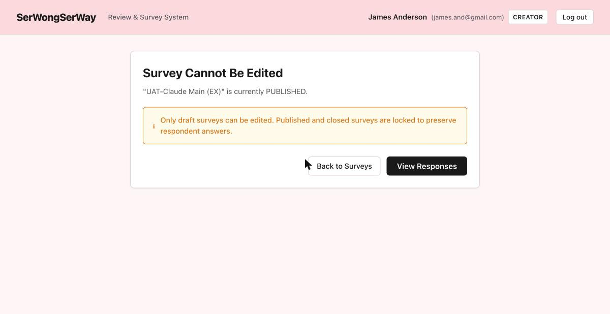

**D-EV03: ผลลัพธ์หลังลอง `PUT` ทั้งหมด คำตอบยังอยู่ครบ (14:32)**

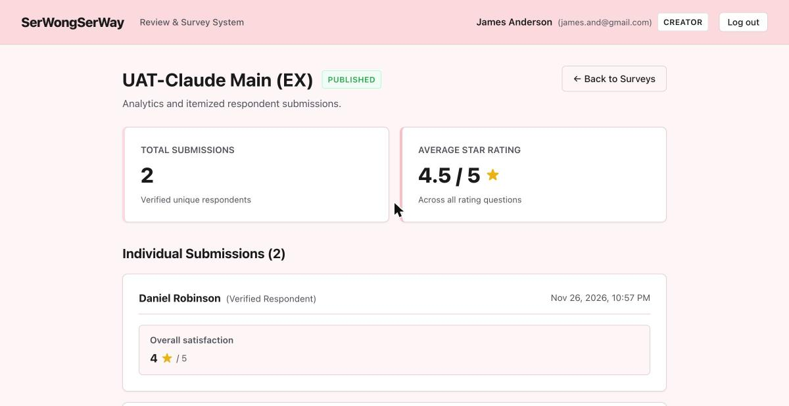

**D-EV04: Regression: survey DRAFT ยังเปิดหน้า edit และแก้ไขได้ (14:32)**

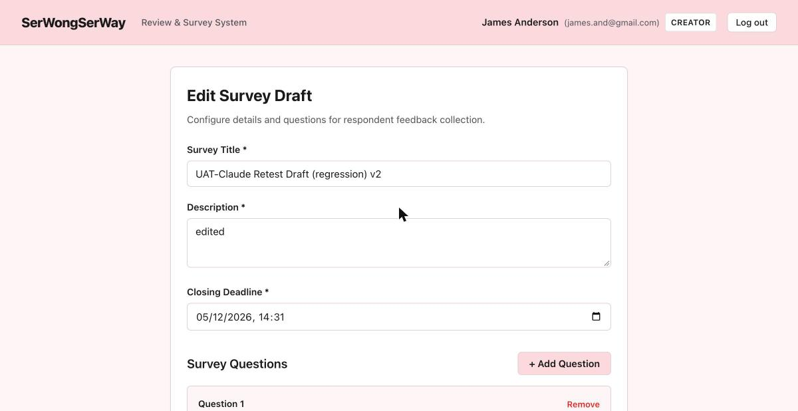

**D-EV05: log ของ API ในการทดสอบซ้ำ (ภาพหน้าจอ)**

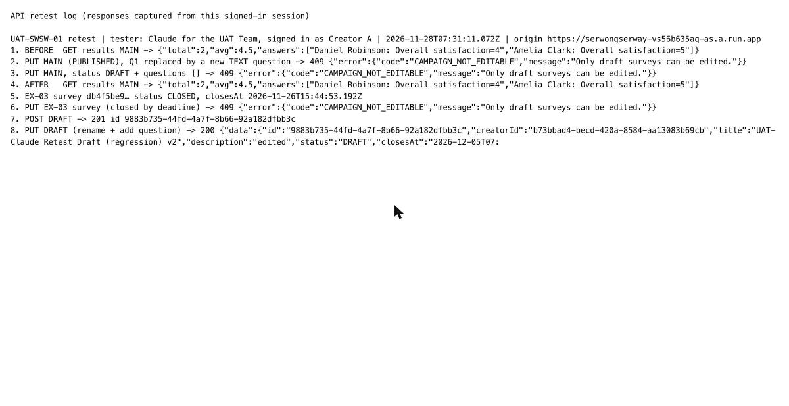

**D-EV06: log ของ API ในการทดสอบซ้ำ (ข้อความ)**

{{file:evidence/d-ev06-retest-api-log.txt}}

**D-EV07: แลกลิงก์ผล UAT กันใน Discord (28 พ.ย. 2026, 01:36)**

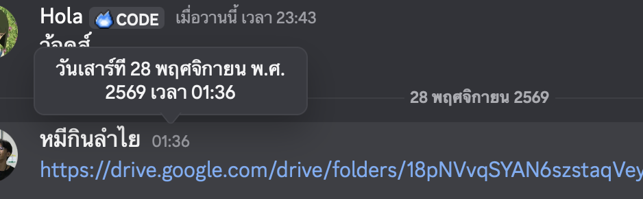

## 4. ข้อสังเกต minor (ฝาก Product Team triage)

- **O-2:** Respondent เปิดหน้า results ได้ 403 ถูกต้อง แต่ error code เป็น `FORBIDDEN` ส่วน STS TEST-11 ของ Product Team ระบุว่าต้องเป็น `FORBIDDEN_OWNER_ACCESS` (EV14) เสนอ severity: minor
- **O-3:** `GET /api/campaigns/:id` ส่ง `creator.email` ไปให้ Respondent เห็นด้วย (EV14) contract ไม่ได้ห้ามไว้ จึงอาจเป็น enhancement
- **O-1:** เคยเห็นหน้า "Loading surveys..." ค้างหลังโดน 403 แต่ลองซ้ำแล้วไม่เกิดอีก (EV08) จึงไม่รายงานเป็น defect

## 5. สิ่งที่ขอจาก Product Team

1. ~~Triage UAT-SWSW-01~~ เสร็จแล้ว (Accepted defect, แก้และยืนยันผลแล้ว) **O-2 และ O-3 ยังรอผล triage** ข้อความที่ Product Team ส่งมายังเป็นตัวเลือกจากแม่แบบที่ยังไม่ได้เลือก ขอให้ระบุว่าแต่ละข้อเป็น accepted, not-defect หรือ enhancement
2. ~~แจ้ง version ใหม่หลังแก้~~ ได้รับแล้ว (`9c7b9eb`, `serwongserway-00012-x7s`) ทดสอบซ้ำเสร็จแล้วในหัวข้อ 3.1

**ข้อมูลทดสอบที่ทิ้งไว้บนระบบ:** survey "UAT-Claude Main (EX)" (`2d1715e8…`) และ "UAT-Claude Closing Soon (EX-03)" (`db4f5be9…`) ของ Creator A รวมถึงคำตอบของ Respondent A และ Respondent B และ survey DRAFT "UAT-Claude Retest Draft (regression) v2" (`9883b735…`) จากการทดสอบซ้ำ ทั้งหมดลบได้แล้วเพราะทดสอบซ้ำเสร็จแล้ว

# ภาคผนวก: หลักฐานทั้งหมด

**EV01: `GET /api/ready` ได้ 200 database connected (22:35)**

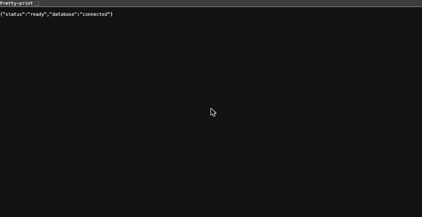

**EV02: `GET /api/campaigns` โดยไม่ login ได้ 401 (22:35)**

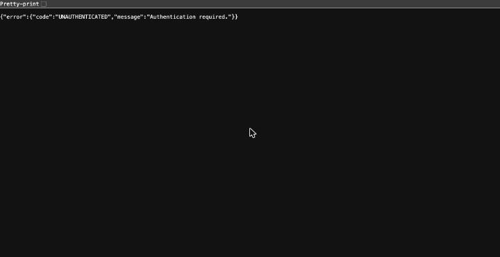

**EV03: Creator A เห็นเฉพาะ survey ของตัวเอง (22:38)**

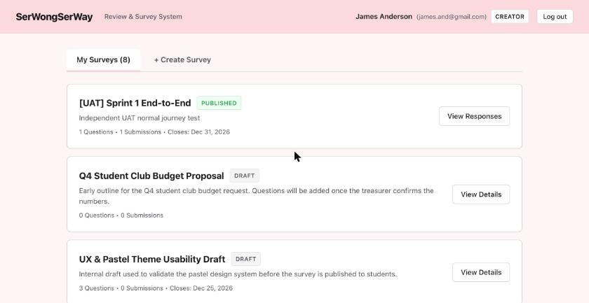

**EV04: survey ทดสอบที่สร้างขึ้น (22:39)**

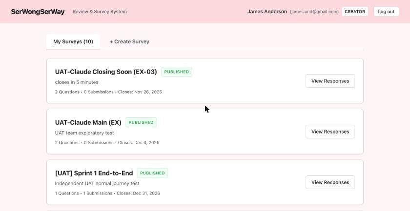

**EV05: UI ไม่ให้ publish ตอนชื่อว่าง (22:40)**

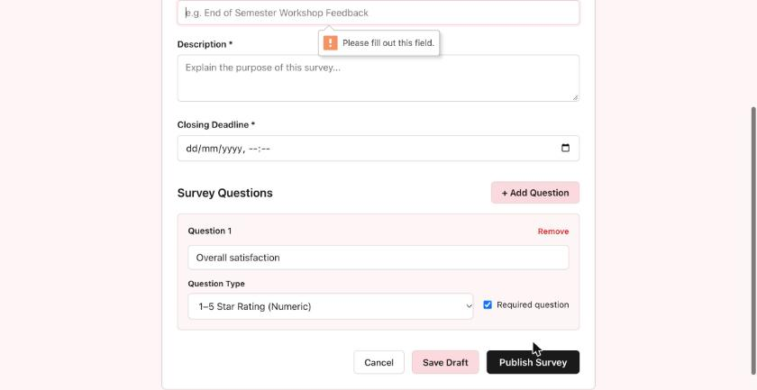

**EV06: Creator A เปิดผลลัพธ์ของ Creator B ถูกปฏิเสธใน UI (22:41)**

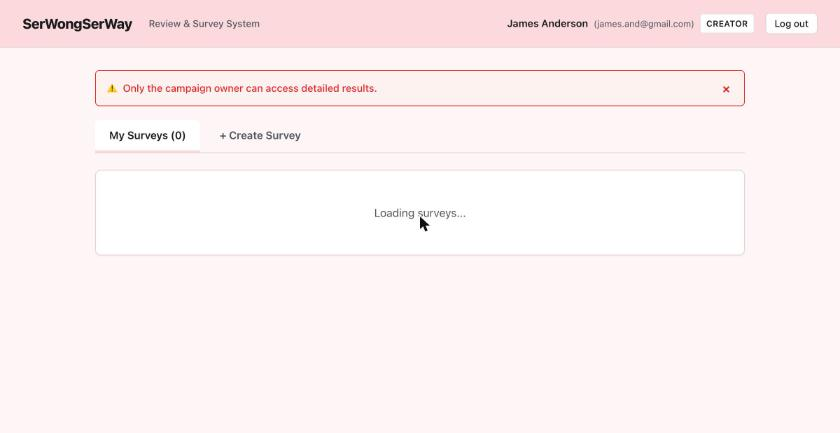

**EV07: API ได้ 403 `FORBIDDEN_OWNER_ACCESS` (22:41)**

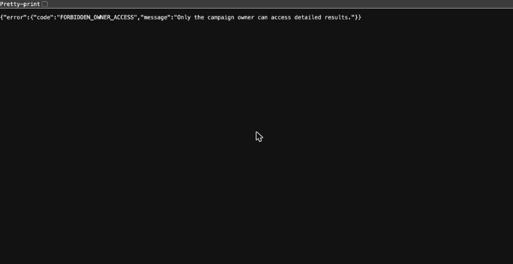

**EV08: รายการ survey โหลดได้ปกติหลังโดน 403 (22:42)**

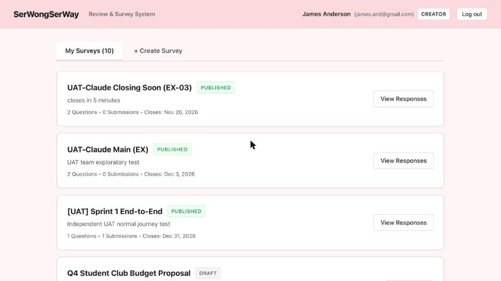

**EV09: กด Log out แล้วกลับไปหน้า login (22:42)**

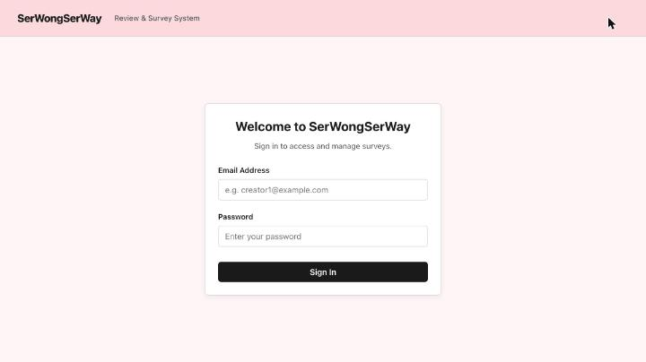

**EV10: กด Back หลัง logout แล้วถูกบล็อก (22:42)**

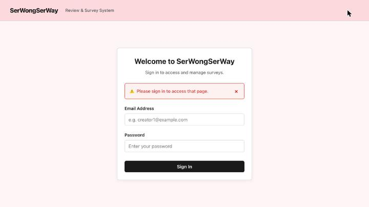

**EV11: Respondent A เห็นเฉพาะ survey ที่ PUBLISHED (22:46)**

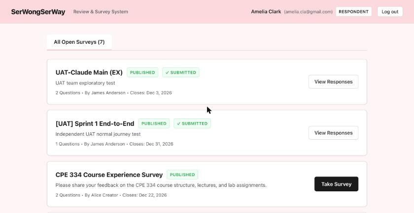

**EV12: Respondent เปิดหน้าผลลัพธ์แล้วถูกปฏิเสธ (22:46)**

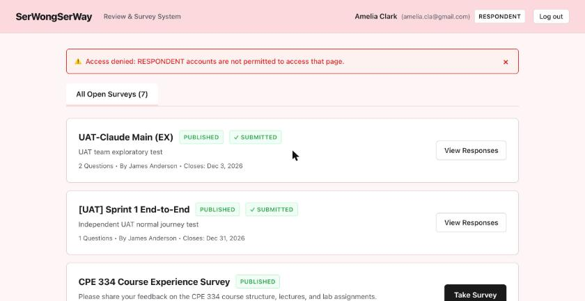

**EV13: คำตอบที่ส่งแล้วยังอยู่ และส่งซ้ำถูกบล็อก (22:46)**

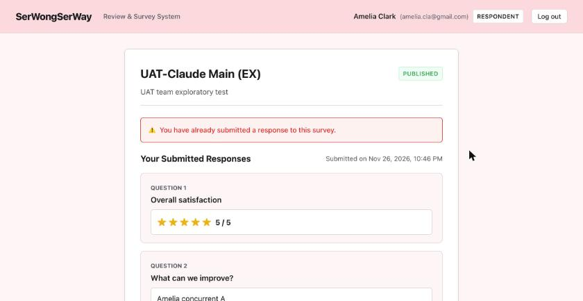

**EV14: log ของ API รอบ Respondent A**

{{file:evidence/b-ev14-round2-api-log.txt}}

**EV15: Respondent B ส่งคำตอบ rating 4 (22:57)**

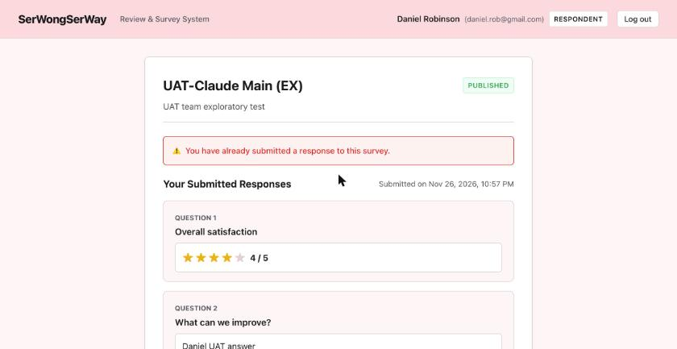

**EV16: ผลลัพธ์ Total 2 ค่าเฉลี่ย 4.5 (23:04)**

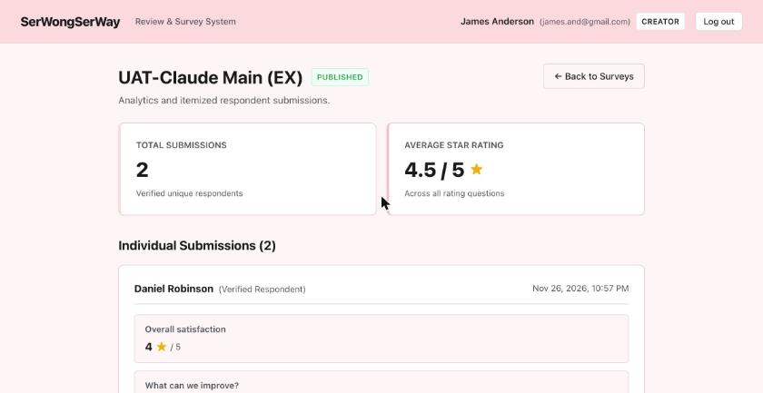
